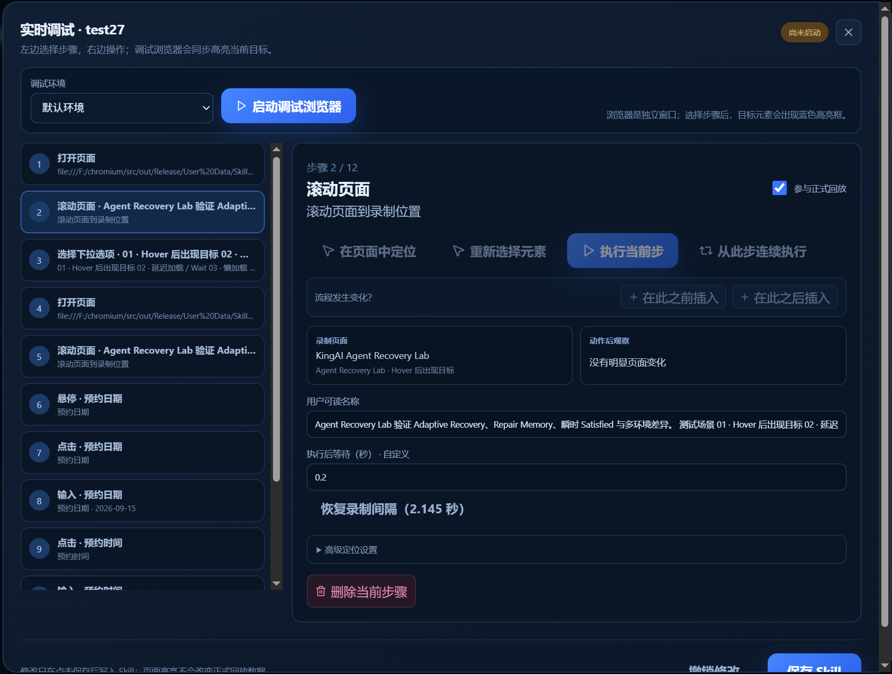

# KingAI Browser: fingerprint environments and agent automation

[English README](README.md) · [中文首页](README.zh-CN.md) · [Official website](https://www.kingaibrowser.cn/) · [Alternative website](https://kingaibrowser.ccwu.cc/)

This overview describes the browser product based on its website source at the time this repository was prepared. Browser implementation is distributed separately; the SDK tests do not verify these engine features.

## Persistent environments / 持久化指纹环境

An environment is a saved identity with a UUID, not just an incognito tab. The browser maintains separate User Data, cookies, cache, proxy settings, configuration and fingerprint noise keys for each environment. Automation can reopen a saved environment by ID, preserving its data across sessions.

每套环境都有独立身份与数据。SDK 返回环境摘要，完整指纹配置由浏览器系统管理；创建环境、使用环境与导出完整指纹不是同一种能力。数据隔离不等于网络匿名，出口 IP 仍由网络与代理配置决定。

## Engine-level fingerprint handling / 引擎层指纹处理

The website describes Chromium/Blink source-level modifications across UA and Client Hints, Canvas, Audio, ClientRects, fonts, WebRTC, WebGL/WebGPU and hardware-related information. Profile startup coordinates language, timezone, proxy region and hardware/graphics templates, and checks for configuration conflicts. The website source currently identifies the product as based on Chromium 155; installed build versions may differ.

这些能力在 Chromium/Blink 层实现，而非由 Python 或 JavaScript SDK 在每个网页里注入一套伪装脚本。长期复用身份时应保留环境配置；明确开启的指纹随机更新会改变相应身份信息。

## Automation detection and humanize / 自动化检测防护与拟人化输入

The browser handles automation-related signals such as `navigator.webdriver` in its source modifications. Browser-layer humanize handles mouse curves, keyboard timing and scrolling. Its input path also addresses mouse button and pressure properties; the website describes `buttons=1` and `pressure=0.5` for mouse-down input. These are event-specific values, not constants for every mouse event.

Agent/SDK consumers use managed MCP tools rather than an unrestricted DevTools connection. They do not obtain internal debugger ports, tokens or raw CDP access from these SDKs. Internal implementation may still use protected browser interfaces; hiding a public endpoint alone does not eliminate every detectable behavior. Humanize requires valid account entitlement at execution time.

源码级修改、配置一致性与输入行为共同减少自动化差异。不能仅凭 MCP 传输、一个 humanize 参数或某个检测页面的成绩，推出对所有网站都有效。这里不复述网站特定环境下的分数作为本 SDK 的测试结果。

## Agent MCP and Skills / Agent MCP 与工作流

Agents discover tools and input schemas from the installed MCP server. Managed browser operations include environment selection, navigation, page reading, snapshots, element interaction, tabs and other installed capabilities. SDK `call` methods provide access to that same tool layer.

Skills bridge recorded workflows and agent execution: a workflow can be recorded in the browser, saved with parameters, then discovered and replayed through MCP. Supported servers provide `skills_list`, `skill_describe`, `skill_run`, `skill_status` and `skill_cancel`. Workflow debugging can inspect steps and reselect elements.

The browser also provides multi-window synchronization. Window synchronization and SDK automation share underlying browser resources; their ownership and concurrency rules remain enforced by the installed Runtime. An SDK connection does not grant permission to take over a manually controlled environment.

## Local execution boundary / 本地执行边界

The SDK owns a stdio MCP child-process connection. MCP talks to Runtime through authenticated IPC; Runtime owns execution and account/profile authorization. The client does not reproduce the browser's fingerprint construction or entitlement logic. Browser installation, login and compatible native components remain prerequisites.

This is a local SDK for an installed desktop product, not a multi-tenant hosting service. A process running as the same desktop user is not an isolated security tenant. Keep executable paths and installation directories trusted, and configure file access roots explicitly when needed.

## What is open here / 本仓库的开源范围

Included: Python, Node.js/TypeScript, Java and Go client code; samples; API contract; in-memory MCP test fixture; sample tests. Excluded: Chromium patches, browser/Manager/MCP/Runtime executables, accounts, credentials, profile databases and production entitlement services.

The [SDK license](LICENSE) applies to included SDK code, not to separately distributed browser binaries. Dependency licenses remain applicable. Reference project for repository presentation: [CloakBrowser](https://github.com/CloakHQ/CloakBrowser); no implementation code is copied from it and no API compatibility is claimed.
