# KingAIBrowser：自己开发了一个网站视频录制的浏览器

> 作者：KingAI浏览器  
> 发布时间：2026年07月12日  
> 来源：[Bilibili](https://www.bilibili.com/opus/1224055607674273798)

---

UP主自主开发的 KingAI 浏览器，其核心功能是将网页视频与直播录制能力直接集成到浏览器中。在普通视频网站和直播页面右上角点击录制、自动保存至本地安装目录下的 `video_record` 目录、停止后即时回放的全流程。该工具仅限个人学习使用，明确禁止用于盗版传播，对于腾讯、爱奇艺等强版权保护平台不支持录制。

---

为了方便学习，可以把视频下载到本地，本人基于 Chromium 151 版本，开发了一个网站视频录制工具，基本适用于常见网站视频及直播，均可录制到本地。与录屏软件原理类似，只是我集成到浏览器了。非常适合自媒体找素材。**只限于学习使用，不要用于视频盗版传播，由此带来的法律问题，由个人承担。**

---

## 1. 录制功能演示

- 直播页面右上角提供"录制"按钮，点击即可启动录制。
- 开始录制后，视频文件立即生成并保存至本地目录。

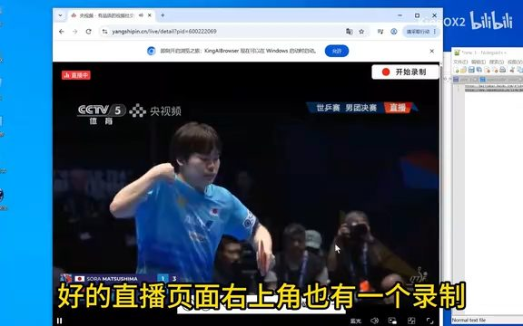

- 点击"停止"后可直接播放已录制的视频，验证录制成功。

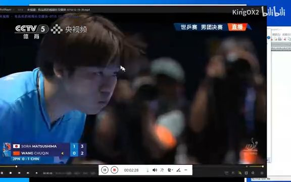

---

## 2. 浏览器介绍与安装说明

- 这是一款由 UP 主自研的专用视频录制浏览器，基于 Chromium 151 最新内核开发。

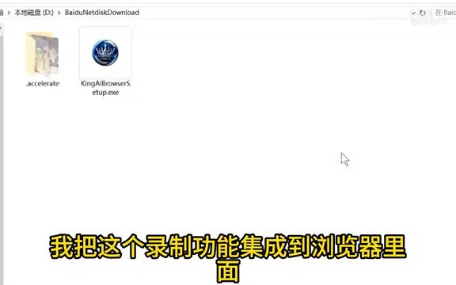

- 安装过程为标准向导式，需阅读并同意版权说明，明确禁止用于盗版传播。

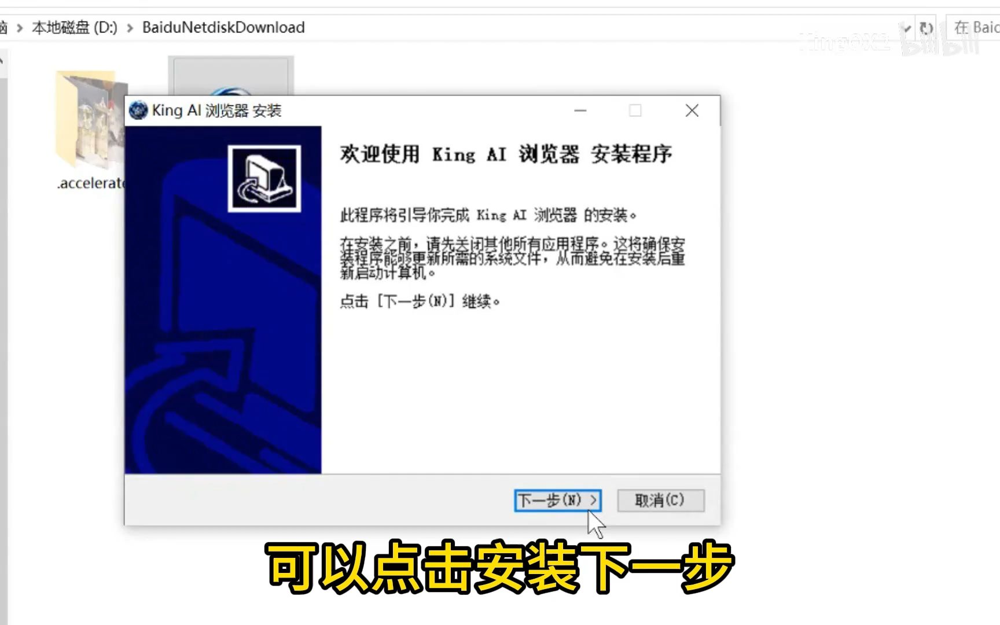

- 默认安装路径为 D 盘，完成安装后自动启动浏览器。

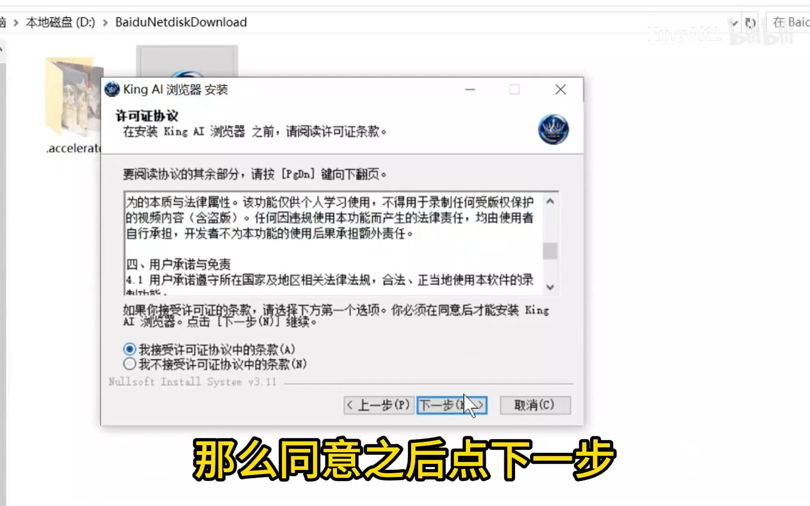

---

## 3. 视频网站录制实测

- 在任意视频网站打开目标内容（如"这次国际研讨会"），右上角出现录制按钮。

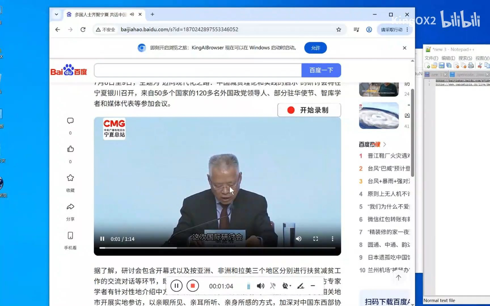

- 点击录制会弹出法律提示框，必须点击"同意"才启动录制流程。

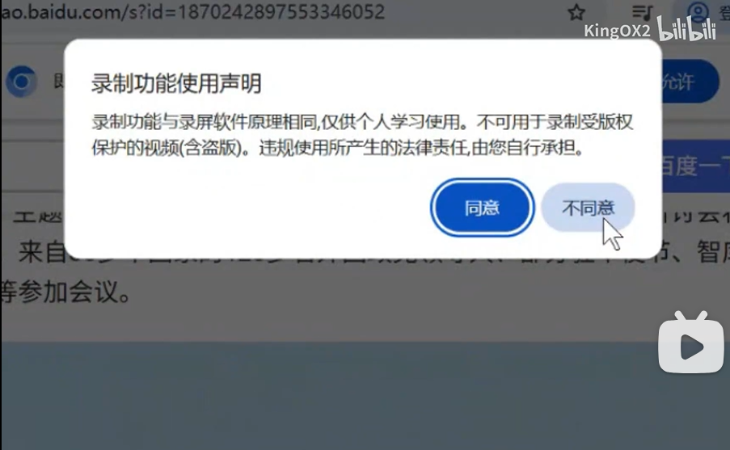

- 录制文件自动保存至 D 盘安装目录下的 `video record` 子目录，命名含视频标题。

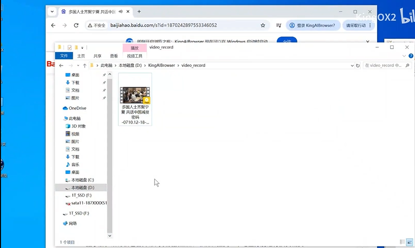

---

## 4. 直播页面录制与兼容性说明

- 直播页面同样支持右上角一键录制，操作逻辑与点播视频一致。

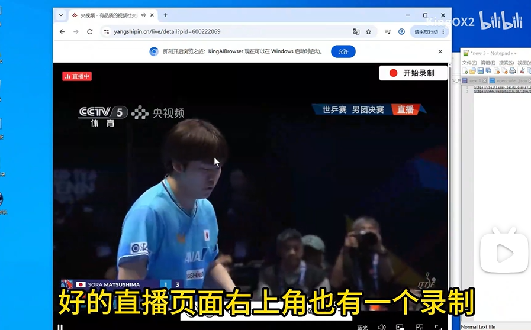

- 录制完成后可立即回放，确认音画同步与完整性。

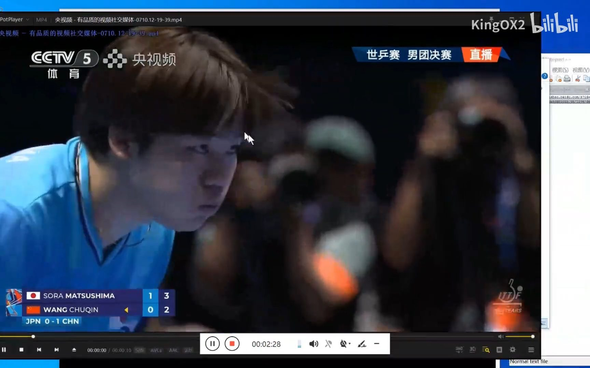

- 明确声明支持市面上绝大多数视频及直播网站，但腾讯、爱奇艺等版权保护严格的平台无法录制。

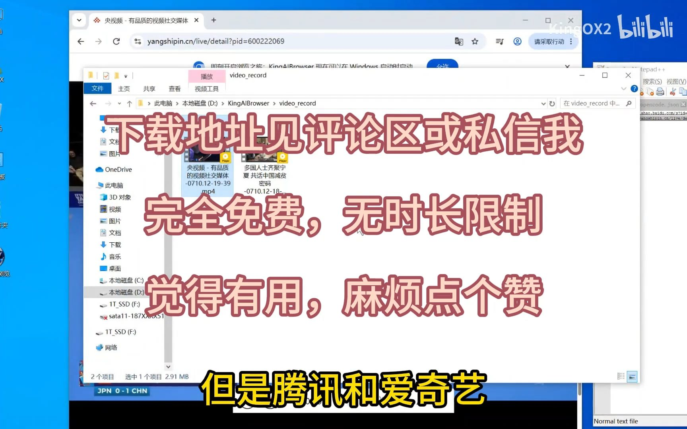

---

## 总结

- KingAIBrowser 浏览器将录屏能力深度集成于浏览器界面，实现网页视频/直播"一键录制"。
- 所有录制文件自动保存至本地安装目录下 `video_record` 目录，命名含视频标题，便于管理。
- 使用前需主动确认法律提示，明确限定用途为个人学习，严禁盗版传播。
- 兼容主流视频与直播网站，但对腾讯、爱奇艺等强 DRM 保护平台不支持录制。
- **注意**：安装时请关闭 360 杀毒，由于是个人开发的浏览器，没有签名 360 会误报。如果担心是病毒，可以在虚拟机下安装。

---

> 📺 **源视频地址**：[自己开发了一个网站视频录制的浏览器](https://www.bilibili.com/video/BV1wmNJ66Eeg?vd_source=1048c046d6f06cce7440c07d0bd4c5c5&spm_id_from=333.1369.0.0)
