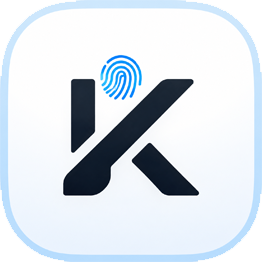
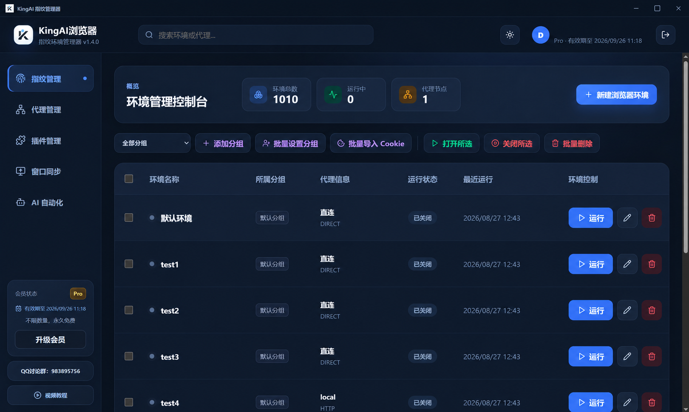
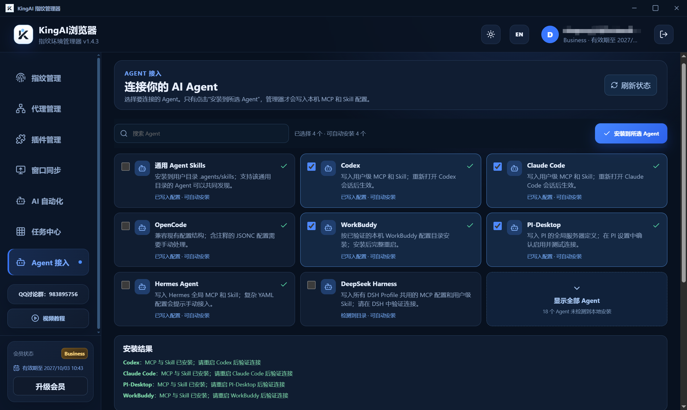

<div align="center">
  
  <h1>KingAI Browser</h1>
  <p><strong>Isolated fingerprint environments. AI agents that operate your browser.</strong></p>
  <p>Python · Node.js / TypeScript · Java · Go · Agent MCP</p>
  <p><a href="README.zh-CN.md">简体中文</a> | English | <a href="https://www.kingaibrowser.cn/">Official Website & Download</a> | <a href="https://kingaibrowser.ccwu.cc/">Alternative Website</a> | <a href="https://www.kingaibrowser.cn/help/en/">Help</a></p>
</div>

KingAI Browser combines persistent fingerprint profiles, Chromium/Blink source-level modifications and browser-native automation. AI agents use its **stdio MCP server**; applications use the **four SDKs in this repository**. Both paths share the installed MCP, Runtime and browser execution layer.

**SDK 0.3.0 · MIT License · No Playwright dependency · No HTTP service required**

This repository contains open-source client SDKs, samples and tests. Download KingAI Browser from the [official website](https://www.kingaibrowser.cn/), [alternative website](https://kingaibrowser.ccwu.cc/) or [GitHub Releases](https://github.com/KingOX-cpp/KingAIBrowser/releases). PyPI/npm/Maven packages have not been published; use source installation below.



## Fingerprint environments + AI automation

| Capability | What it provides |
| --- | --- |
| Persistent fingerprint profiles | Each UUID profile has its own browser data, cookies, cache, proxy configuration and fingerprint noise key. Reuse a saved identity across sessions. |
| Chromium / Blink modifications | Engine-level handling of UA / Client Hints, Canvas, Audio, ClientRects, fonts, WebRTC, WebGL / WebGPU and hardware-related surfaces. |
| Configuration consistency | Coordinates language, timezone, proxy region and hardware/graphics information, with startup validation of conflicting settings. |
| Browser-native humanize | Mouse trajectories, keyboard timing and scrolling in the browser input layer, including button/pressure handling. Requires account entitlement. |
| Agent MCP | Open profiles, inspect pages, click, type, navigate, manage tabs and exchange structured results through stdio MCP. |
| Reusable Skills | Record workflows in the browser; agents discover parameters, start playback, query status or cancel through MCP. |
| Four SDKs | Python, Node.js/TypeScript, Java and Go invoke the same MCP tools. |

The browser also includes multi-window synchronization and Skill debugging. Availability follows the installed version and account entitlement. See [browser technology](BROWSER_TECHNOLOGY.md).

## Automation signals and CDP detection

KingAI addresses automation detection inside Chromium/Blink and the browser input layer, including `navigator.webdriver` and button/pressure data in automated mouse events. Agents connect through **managed MCP tools** without requesting a DevTools port or debugger WebSocket URL.

The SDK does not expose unrestricted raw CDP or require Playwright/Puppeteer. Internal execution can still use protected Chromium interfaces; stdio alone does not remove automation signals. These modifications aim to reduce detectable automation differences, **not guarantee acceptance by every site**. IP reputation, account history, behavior and changing website rules also matter.

## Architecture

```text
AI agent ──────────────────────────┐
                                  ▼
Python / Node.js / Java / Go → installed KingAI MCP (stdio)
                                  │ authenticated IPC
                                  ▼
                              KingAI Runtime
                                  │
                                  ▼
                    KingAI Browser + saved profile
```

Each SDK owns its MCP child-process connection. No SDK HTTP daemon is needed. Runtime manages browser execution and account/profile access. Complete fingerprint configurations stay in the browser system.

## Before you start

1. Install KingAI Browser and sign in through its Manager. MCP/Runtime must support the tools required by SDK 0.3.0; SDK installation alone does not upgrade them.
2. Locate **KingAIMcpServer.exe**, with **KingAIRuntime.exe** beside it. The main browser executable is not the MCP server.
3. Set the path below, or use the installation record written by a compatible Manager. The Manager need not stay open just for path discovery.

```powershell
# Replace the example path with your installed MCP executable.
$env:KINGAI_MCP_EXECUTABLE = 'D:\Apps\KingAIBrowser\KingAIMcpServer.exe'
git clone https://github.com/KingOX-cpp/KingAIBrowser.git D:\code\KingAIBrowser
cd D:\code\KingAIBrowser
```

Discovery: explicit SDK option → `KINGAI_MCP_EXECUTABLE` → per-user Manager record. No disk scanning or automatic browser download. The sample runner targets Windows; other platform paths in the SDK are not proof of tested browser availability.

## Python

Python 3.10+; runtime library uses only the standard library.

```powershell
New-Item -ItemType Directory -Force D:\code\kingai-sdk-temp | Out-Null
$env:TEMP = 'D:\code\kingai-sdk-temp'
$env:TMP = $env:TEMP
python -m pip install --cache-dir D:\code\kingai-sdk-cache\pip .\python
python .\examples\sync.py --live
```

```python
from kingai_browser import KingAI

with KingAI() as api:
    print(api.profiles())
    profile = api.create_profile("My Python profile")
    browser = api.start(profile_id=profile["profileId"])
    browser.new_tab("https://example.com")
    print(browser.read())
    browser.detach()
```

Also includes `AsyncKingAI` and the `BrowserAutomation` agent facade. [Python docs](python/README.md) · [sync sample](examples/sync.py) · [async sample](examples/async.py).

## Node.js / TypeScript

Node.js 22+. Install the local package from your application directory:

```powershell
npm install --cache D:\code\kingai-sdk-cache\npm D:\code\KingAIBrowser
```

```javascript
import { KingAI } from '@kingai/browser-api';

const api = new KingAI();
try {
  console.log(await api.profiles());
  const profile = await api.createProfile('My Node profile');
  const browser = await api.start({ profile_id: profile.profileId });
  await browser.newTab('https://example.com');
  console.log(await browser.read());
  await browser.detach();
} finally { await api.close(); }
```

TypeScript declarations are included. To run the [repository sample](examples/node.mjs), install dependencies in the repository with `npm install --cache D:\code\kingai-sdk-cache\npm`, then run `node examples/node.mjs --live`.

## Java

Java 17+ and Maven; uses Jackson and connects directly over stdio.

```powershell
mvn -f java/pom.xml -Dmaven.repo.local=D:/code/kingai-sdk-cache/m2 -Dkingai.build.directory=D:/code/kingai-sdk-build/java install
```

Your application can then depend on local Maven artifact `cn.kingaibrowser.sdk:kingai-browser:0.3.0`, using the same local repository path. This is not a Maven Central release.

```java
import cn.kingaibrowser.sdk.KingAI;

try (KingAI api = new KingAI()) {
    System.out.println(api.profiles());
    KingAI.Session browser = api.start(); // Existing saved 默认环境
    browser.newTab("https://example.com");
    System.out.println(browser.read());
    browser.detach();
}
```

[Java docs](java/README.md) · [full profile-creation sample](java/src/main/java/cn/kingaibrowser/sdk/samples/Sample.java).

## Go

Go 1.24+. In your application's `go.mod`, use the local checkout:

```go
require github.com/KingOX-cpp/KingAIBrowser/go v0.0.0
replace github.com/KingOX-cpp/KingAIBrowser/go => D:/code/KingAIBrowser/go
```

`v0.0.0` is a local-replace placeholder, not a published release tag. Import `kingai "github.com/KingOX-cpp/KingAIBrowser/go"` and call:

```go
api, err := kingai.Connect(ctx, kingai.Options{})
if err != nil { return err }
defer api.Close()
browser, err := api.Start(ctx, nil) // Existing saved 默认环境
if err != nil { return err }
if _, err = browser.NewTab(ctx, "https://example.com"); err != nil { return err }
page, err := browser.Read(ctx)
if err != nil { return err }
fmt.Println(page)
_, err = browser.Detach(ctx)
return err
```

The snippet is a function body with `context` and `fmt` imported by the caller. Set `GOMODCACHE`, `GOCACHE`, `GOTMPDIR` to D: before resolving dependencies. [Go docs](go/README.md) · [runnable sample](go/examples/basic/main.go). From `go/`, run `go run ./examples/basic --live`.

## Connect an AI agent through MCP

Use **Agent integration** in the Manager to install MCP into a supported agent. For a client with manual stdio configuration, adapt this to its configuration format:

```json
{
  "mcpServers": {
    "kingai-browser": {
      "command": "D:\\Apps\\KingAIBrowser\\KingAIMcpServer.exe",
      "args": []
    }
  }
}
```

Replace the path. The agent must support MCP stdio and accept the server connection. `tools/list` provides the authoritative schemas. Supported server versions provide Skill tools: `skills_list`, `skill_describe`, `skill_run`, `skill_status`, `skill_cancel`.

Example prompt: “Open my saved Research profile, visit example.com and read the page. Keep the browser open when finished.”



## Samples and tests

Samples and tests call the same reusable sample functions. Real CLI use requires `--live`; samples create saved profiles and detach, leaving browser windows open. Repeated use of the same name can return a duplicate-name error. The async sample uses the existing default profile.

The source SDK's previous Windows run passed **17 fixture-backed tests**: Python 7, Node.js 4, Java 3, Go 3. These exercise SDK stdio communication with an in-memory MCP simulator, sample sequences, selected CRUD errors, no automatic replay, observation locking and preview bounds. **This public-repository layout and updated Go module path have not been retested.** These tests do not validate real browsing, fingerprint detection or account entitlements.

See [sample/test details](SAMPLES.md). With Python, Node.js, Java, Maven and Go installed:

```powershell
.\tests\Run-Samples.ps1 -GoExecutable go -MavenCommand mvn.cmd
```

The runner keeps dependencies/outputs on D: and does not build Chromium or Rust. Tests do not fall back to a real browser when the test MCP path is absent.

## API behavior to know

- `tools` / `Tools` and `call` / `Call` expose available MCP tools. Raw arguments remain snake_case; returned IDs include `sessionId` and `targetId`.
- `start()` without a profile selects the existing unique **默认环境**. It does not create a missing default. Temporary profiles require an explicit request.
- Client close disconnects its MCP. Explicit session close methods close browsers. Profile CRUD requires a compatible installed MCP/Runtime and login.
- Account limits apply to concurrently open environments, not clicks or SDK calls. Humanize requires a valid entitlement; requested flags/metadata alone do not prove it was applied.
- Input may require a visible selected page. For `PAGE_NOT_VISIBLE`, restore the window and activate the intended tab.
- Sessions use selected tabs; serialize multi-step workflows. These are not Playwright-compatible multi-Page objects.
- Timeout/disconnection does not prove an action failed. Side effects are not automatically retried. Use explicit preview methods for bounded evaluation results.

[API contract](CONTRACT.md) · [source installation / release notes](RELEASE.md) · [GitHub Issues](https://github.com/KingOX-cpp/KingAIBrowser/issues). Remove secrets and account data from reports.

## License

The Python, Node.js, Java and Go SDKs, samples and tests are available under the [MIT License](LICENSE). You may use, copy, modify, redistribute and use them commercially while retaining the copyright and license notice. Applicable third-party notices are preserved in [THIRD_PARTY_NOTICES.txt](THIRD_PARTY_NOTICES.txt). This repository does not vendor CloakBrowser code.

## Websites and browser downloads

- Official website: **https://www.kingaibrowser.cn/**
- Alternative website: **https://kingaibrowser.ccwu.cc/**
- Browser downloads on GitHub Releases: **https://github.com/KingOX-cpp/KingAIBrowser/releases**
