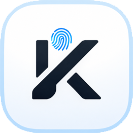
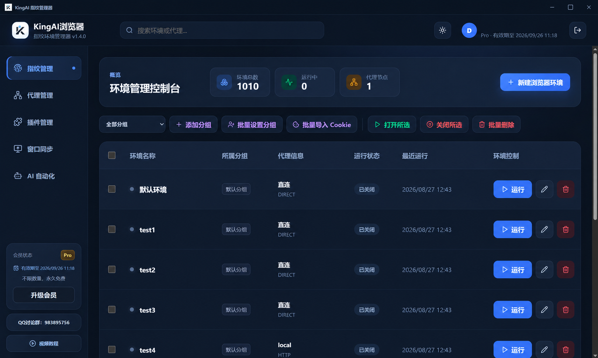
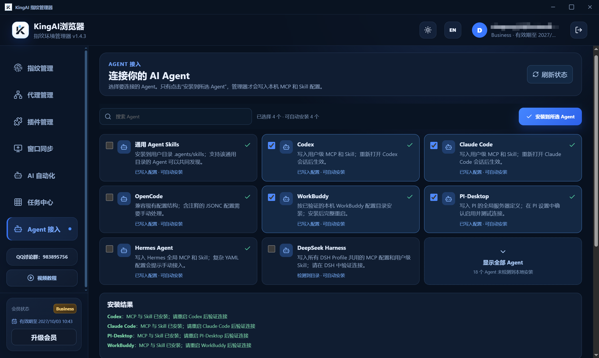

<div align="center">
  
  <h1>KingAI Browser</h1>
  <p><strong>独立指纹环境，让 AI Agent 真正操控浏览器。</strong></p>
  <p>Python · Node.js / TypeScript · Java · Go · Agent MCP</p>
  <p>简体中文 | <a href="README.md">English</a> | <a href="https://www.kingaibrowser.cn/">官方网站</a> | <a href="https://kingaibrowser.ccwu.cc/">备用网站</a> | <a href="https://www.kingaibrowser.cn/help/zh/">使用帮助</a></p>
</div>

[](https://pypi.org/project/kingai-browser/)
[](https://www.npmjs.com/package/@kingaibrowser/browser-api)
[](LICENSE)
[](https://github.com/KingOX-cpp/KingAIBrowser/releases)

KingAI Browser 是面向 **AI Agent 与多账号自动化的指纹浏览器（anti-detect browser）**。持久化指纹环境隔离账号数据并保留登录状态；通过 **MCP Server** 或 Python、Node.js、Java、Go SDK 操控已安装的浏览器。

如果你在寻找保留登录态的浏览器自动化方案，可以使用 KingAI 的 stdio MCP 高层接口，无需依赖 Playwright，也不对外开放无限制 raw CDP。它采用独立 API，不能直接替换现有 Playwright 代码。

**基于 Chromium 155 内核（155.0.8059.40）。** KingAI 提供持久化、相互隔离的账号环境，属于 antidetect / stealth browser。可用于规划经授权的电商（e-commerce）账号操作与保留登录态的 Agent 任务。stealth 指指纹与自动化信号防护，不是 undetected（永不被检测）承诺；Playwright/Puppeteer 用户需使用 KingAI 自己的 MCP/SDK API。

**Python 0.3.3 · Node.js 0.3.0 · SDK 采用 MIT 协议 · 无需 HTTP 服务**

本仓库开源客户端 SDK、调用示例和测试。浏览器可从[官方网站](https://www.kingaibrowser.cn/)、[备用网站](https://kingaibrowser.ccwu.cc/)或 [GitHub Releases](https://github.com/KingOX-cpp/KingAIBrowser/releases) 下载。Python SDK 0.3.3 已[发布到 PyPI](https://pypi.org/project/kingai-browser/0.3.3/)，可运行 `python -m pip install kingai-browser` 在线安装；Node.js SDK 也已[发布到 npm](https://www.npmjs.com/package/@kingaibrowser/browser-api)；Maven 公共包尚未发布。

## 在线安装

[提问或分享使用场景](https://github.com/KingOX-cpp/KingAIBrowser/discussions) · [反馈问题](https://github.com/KingOX-cpp/KingAIBrowser/issues/new/choose)

Python 和 Node.js SDK 均已发布，可以直接在线安装，无需先克隆本仓库。

Python：

```shell
pip install kingai-browser
python -m kingai_browser install
```

Node.js / TypeScript（两条命令均在你的调用项目目录中运行）：

```shell
npm install @kingaibrowser/browser-api
npx kingai-browser install
```

第一条安装 SDK，第二条显式下载并打开浏览器安装界面。安装包默认下载到系统临时目录，由用户自行完成安装，再打开 Manager 登录；已有安装可能直接复用。这不是静默安装。Node.js 要求 22 或以上版本，npx 应在已安装该包的项目目录运行，以使用本地 kingai-browser 命令。

[PyPI 包主页](https://pypi.org/project/kingai-browser/) · [npm 包主页](https://www.npmjs.com/package/@kingaibrowser/browser-api) · [完整安装说明](INSTALLATION.zh-CN.md)

## 第一次自动化

先安装浏览器，打开 Manager 登录，并创建唯一名为 `默认环境` 的已保存环境，再运行以下代码。示例复用该环境，不创建临时环境。

```python
from kingai_browser import launch

with launch() as browser:
    browser.new_tab("https://example.com")
    print(browser.read())
```

退出 with 会释放连接并保留窗口；需要关闭窗口时请显式调用关闭浏览器的方法。[更多示例](examples/README.md) · [故障排查](TROUBLESHOOTING.md)。



## 浏览器下载安装

支持 Windows Intel/AMD x64 和 Apple 芯片 Mac，不支持 Windows ARM、32 位 Windows 或 Intel Mac。四语言均提供原生下载实现；显式安装命令可下载并打开安装向导/DMG，仍需用户完成安装，不是静默安装。

```powershell
python -m kingai_browser install --download-only
# Download and open the installer UI
python -m kingai_browser install
```

```python
from kingai_browser import install
result = install(download_only=True)
print(result["status"], result["installerPath"])
```

Windows 和 macOS 安装包默认下载到系统临时目录；下载目录不是浏览器安装目录。证书校验保持开启，IP 证书不可信或不匹配会失败；可传可信 SHA-256 校验文件。安装后打开 Manager 登录并运行 doctor。新增下载/安装入口本轮未下载或执行安装包，未运行构建、检查或测试。

[完整安装说明](INSTALLATION.zh-CN.md)

## 六大功能

KingAI Browser 不只是自动化 SDK，也是集网页工具、独立指纹环境与 AI 工作流于一体的浏览器。以下六项与官网功能介绍保持一致。

| 功能 | 介绍 | 主要能力 |
| --- | --- | --- |
| **01 · 网页视频录制** | 鼠标悬停在支持的播放器上即可开始或停止录制，按钮随播放器移动，不遮挡画面；完成后保存到本地并提示文件路径。 | HTML `<video>` 原生捕获、标签页关闭时自动收尾、独立进程异步写入文件。 |
| **02 · 网页文字操作增强** | 当网页脚本阻止选中、复制或右键菜单时，通过显式快捷操作处理页面中实际存在的 DOM 文本。 | `Shift + 右键` 调用原生菜单、`Alt + C` 复制当前选择、`Alt + 拖拽` 临时选择。 |
| **03 · 永久免费指纹管理器** | 创建、编辑、分组和启动多套保存环境，每套环境独立保存 User Data、Cookie、代理及配置。 | 日常环境管理不限制环境数量与启动次数；环境数据与身份配置隔离，可配置独立代理。 |
| **04 · 源码级指纹补丁 + humanize** | 在 Chromium/Blink 层处理关键指纹面，在浏览器输入层实现自然化操作。 | Canvas / Audio / ClientRects 固定噪声、WebGL / WebGPU 真实硬件模板、自然鼠标轨迹、键入节奏与连续滚动。 |
| **05 · 窗口同步** | 一个主控窗口实时同步多个浏览器，各窗口保留各自的指纹、Cookie 和代理。 | 鼠标、键盘、滚动、中文输入、地址栏粘贴、标签页操作，以及多显示器和网格布局。 |
| **06 · AI 自动化** | 将真实操作录制成可复用 Skill，由内置 Agent 辅助适配页面与元素变化，也可让外部 Agent 通过 MCP 调用。 | Skill 录制与回放、单步调试与元素重定位、Agent MCP 接入、四语言 SDK。 |

永久免费指纹管理指日常环境管理与手动启动；窗口同步、humanize、Skill 和 MCP 并发等能力按当前账号权益开放。视频录制以支持的 HTML 视频播放器为基础；文字增强只处理实际 DOM 文本，不包含图片或 Canvas 文字识别。

## DETECTION MATRIX

以下为官网展示的检测对照及浏览器级实现说明。表中 Chrome + Playwright 一栏描述官网对照配置，不能视为所有 Playwright 配置的固定行为。

| 检测项目 | Chrome + Playwright（官网对照配置） | KingAI Browser | 实现方式 |
| --- | --- | --- | --- |
| reCAPTCHA v3 | **0.1 · bot** | **0.9 · human** | 服务端验证，特定环境实测。 |
| `navigator.webdriver` | `true` | `false` | Chromium / Blink 源码级补丁。 |
| UA / Client Hints | 随浏览器内核使用默认值 | 按环境配置并保持一致 | UA、品牌、版本与平台交叉校验。 |
| CDP Error stack 检测 | 可触发检测钩子 | 阻止检测副作用 | V8 Inspector 保护。 |
| 鼠标按下信号 | buttons / pressure 常见缺省为 0 | **buttons 1 · pressure 0.5** | Chromium 输入层显式传递；此处指左键按下事件。 |
| 鼠标移动与点击 | 直线或固定坐标 | 贝塞尔曲线与自然节奏 | 浏览器输入层 humanize。 |
| 拟人化输入 | 一次性输入 | 节奏、错输与回退 | 浏览器输入层 humanize。 |
| 指纹环境一致性 | 需自行拼装与维护 | 多配置面统一校验 | 源码补丁与启动前校验。 |

**0.1 / 0.9 是官网记录的特定配置、网络和测试流程下的实测对照，不是本仓库 SDK 测试结果，也不构成对任意网站、风控或验证码的通过保证。** 代理质量、账号历史和实际操作行为都会影响结果；humanize 需要有效账号权益。


生命周期更新：Python launch 上下文和 Java Session 自动资源退出会 detach 并保留窗口。显式关闭分别使用 Python close()/close_browser()、Node close()/closeBrowser()、Java closeBrowser()、Go Close()/CloseBrowser()。新增 ownership、launch、doctor 均未执行验证，历史 17 项测试不覆盖这些改动。

连接释放后，原 Session 对象不能继续操作保留窗口。可在 Manager 中关闭，或由新客户端发现真实会话、在授权允许时显式 attach 后关闭；SDK 不自动重连。Java closeBrowser() 在客户端已关闭时抛 SESSION_DISCONNECTED。

## 快速入口与诊断

先看[四语言入口区别与用法](docs/SDK_ENTRY_POINTS.zh-CN.md)：包括 launch、显式客户端、Agent facade 的能力矩阵、示例和生命周期。BrowserAutomation 当前在 Python/Node 提供，Java/Go 目前只有客户端与会话层。[English](docs/SDK_ENTRY_POINTS.md)。

先选适合自己的 Python 入口：[launch、KingAI、BrowserAutomation 的区别与完整用法](python/ENTRY_POINTS.zh-CN.md)，包含参数、返回对象、DOM 获取及退出后窗口是否保留。[English](python/ENTRY_POINTS.md)。

```python
from kingai_browser import launch

with launch() as browser:
    browser.new_tab("https://example.com")
    print(browser.read())
```

先安装并登录浏览器。launch 默认使用已有唯一“默认环境”；上下文结束时 detach 并保留浏览器。其他语言入口与显式环境选择见各 SDK 文档。

```powershell
python -m kingai_browser doctor
node js/cli.mjs doctor
```

[Troubleshooting / 故障排查](TROUBLESHOOTING.md). 本轮新增入口和诊断尚未执行验证。

## 指纹环境与 AI 自动化

| 能力 | 技术与用途 |
| --- | --- |
| 持久化指纹环境 | 每个 UUID 环境独立保存浏览器数据、Cookie、缓存、代理配置和指纹噪声 Key，支持跨会话复用同一身份。 |
| Chromium / Blink 源码级修改 | 在浏览器引擎层处理 UA / Client Hints、Canvas、Audio、ClientRects、字体、WebRTC、WebGL / WebGPU 和硬件相关指纹面。 |
| 跨指纹面一致性 | 协调语言、时区、代理地区、硬件和图形配置，并在启动前校验冲突。 |
| 浏览器原生 humanize | 鼠标轨迹、键盘节奏、滚动在浏览器输入层实现，同时处理鼠标按键与压力信号；实际使用需要有效会员权益。 |
| 面向 Agent 的 MCP | 打开保存环境、读取页面、定位元素、点击、输入、导航、管理标签页，以结构化结果供 Agent 决策。 |
| 可复用 Skill | 在浏览器中录制工作流；Agent 通过 MCP 发现参数、启动回放、查询进度和取消任务。 |
| 四种语言 SDK | Python、Node.js/TypeScript、Java、Go 调用同一套 MCP 工具，便于接入自己的 Agent 或业务程序。 |

浏览器还提供多窗口同步、Skill 单步调试等能力。指纹管理器的日常环境管理与启动免费；humanize、自动化并发等权益以当前安装版和账号配置为准。SDK 不改变原有权限与额度规则。详见[浏览器技术介绍](BROWSER_TECHNOLOGY.md)。

## CDP 检测与自动化信号防护

KingAI 的自动化信号防护落在 **Chromium/Blink 源码层和浏览器输入层**，包括 `navigator.webdriver`、自动化鼠标事件的 buttons / pressure 等。Agent 经由受控 MCP 工具操作浏览器，**无需获取 DevTools 端口、调试 WebSocket URL，也无需 Playwright/Puppeteer 连接**。

SDK 不开放无限制 raw CDP。浏览器内部仍可能使用受保护的 Chromium 接口；stdio 传输本身并不能消除自动化信号。上述设计用于减少可识别的自动化差异，**不代表所有网站都无法检测或一定放行**；代理 IP、账号历史、行为和网站规则也会影响结果。

## 调用架构

```text
AI Agent ─────────────────────────┐
                                  ▼
Python / Node.js / Java / Go → 安装版 KingAI MCP（stdio）
                                  │ 认证 IPC
                                  ▼
                              KingAI Runtime
                                  │
                                  ▼
                         KingAI 浏览器 + 指纹环境
```

SDK 管理自己的 MCP 子进程连接，不需要额外部署 HTTP 常驻服务。Runtime 负责浏览器执行和账号/环境访问，SDK 不自行拼装或导出完整指纹配置。

## 使用前准备

1. 安装 KingAI Browser，通过管理器登录。MCP 与 Runtime 须配套，且支持 SDK 0.3.0 所需工具；仅更新 SDK 不会升级浏览器服务。
2. 找到 **KingAIMcpServer.exe**，旁边应有 **KingAIRuntime.exe**。浏览器主程序不是 MCP Server。
3. 设置路径，或使用兼容管理器写入的当前用户安装登记；管理器不需要仅为路径发现一直开着。

```powershell
# 将示例替换为自己安装目录里的 MCP 程序。
$env:KINGAI_MCP_EXECUTABLE = 'D:\Apps\KingAIBrowser\KingAIMcpServer.exe'
git clone https://github.com/KingOX-cpp/KingAIBrowser.git D:\code\KingAIBrowser
cd D:\code\KingAIBrowser
```

定位优先级：SDK 显式参数 → `KINGAI_MCP_EXECUTABLE` → 管理器安装登记。路径定位和 launch 不扫描磁盘、不自动下载浏览器；需要下载时显式调用上面的 install 入口。目前示例测试脚本面向 Windows；源码中的其他平台路径不代表对应浏览器发行版已经验证。

## 完整自动化示例

推荐先看[完整流程与运行说明](examples/README.md)：获取环境列表、创建和设置环境 → 获取 DOM → 查询元素 → 输入 → 点击 → 确认提交结果。仓库附带本地演示表单，不依赖第三方网站。

| Python | Node.js | Java | Go |
| --- | --- | --- | --- |
| [browser_form_automation.py](python/examples/browser_form_automation.py) | [browser_form_automation.mjs](js/examples/browser_form_automation.mjs) | [Workflow.java](java/src/main/java/cn/kingaibrowser/sdk/samples/Workflow.java) | [main.go](go/examples/workflow/main.go) |

SDK 分别放在 `python/`、`js/`、`java/`、`go/`。根目录的 `examples/` 提供公共演示页面和导航。下方片段用于快速入门，完整交互请看上面的 workflow 示例。

## Python

要求 Python 3.10+，运行时仅使用 Python 标准库。

```powershell
New-Item -ItemType Directory -Force D:\code\kingai-sdk-temp | Out-Null
$env:TEMP = 'D:\code\kingai-sdk-temp'
$env:TMP = $env:TEMP
python -m pip install --cache-dir D:\code\kingai-sdk-cache\pip .\python
python .\python\examples\browser_form_automation.py --live
```

```python
from kingai_browser import KingAI

with KingAI() as api:
    print(api.profiles())                    # 获取保存环境
    profile = api.create_profile("Python 演示环境")
    browser = api.start(profile_id=profile["profileId"])
    browser.new_tab("https://example.com")
    print(browser.read())
    browser.detach()                        # 结束会话，保留浏览器
```

同时提供 `AsyncKingAI` 异步入口与 `BrowserAutomation` Agent 封装。[Python 说明](python/README.md) · [环境管理示例](python/examples/profile_management.py) · [异步表单示例](python/examples/async_browser_form_automation.py)。

## Node.js / TypeScript

要求 Node.js 22+。在自己的调用项目中通过 npm 在线安装 SDK，再下载并打开浏览器安装界面：

```powershell
npm install @kingaibrowser/browser-api
npx kingai-browser install
```

```javascript
import { KingAI } from '@kingaibrowser/browser-api';

const api = new KingAI();
try {
  console.log(await api.profiles());
  const profile = await api.createProfile('Node 演示环境');
  const browser = await api.start({ profile_id: profile.profileId });
  await browser.newTab('https://example.com');
  console.log(await browser.read());
  await browser.detach();
} finally { await api.close(); }
```

提供 TypeScript 类型声明。运行[仓库 sample](js/examples/saved_profile_quickstart.mjs)前，在 js/ 目录执行 `npm install --cache D:\code\kingai-sdk-cache\npm`，然后在 js/ 目录执行 `node examples/saved_profile_quickstart.mjs --live`。

## Java

要求 Java 17+ 和 Maven，使用 Jackson 编解码，直接通过 stdio 连接 MCP。

```powershell
mvn -f java/pom.xml -Dmaven.repo.local=D:/code/kingai-sdk-cache/m2 -Dkingai.build.directory=D:/code/kingai-sdk-build/java install
```

调用项目使用相同本地 Maven 仓库，并添加依赖 `cn.kingaibrowser.sdk:kingai-browser:0.3.0`。该坐标目前仅供本地安装，尚未发布 Maven Central。

```java
import cn.kingaibrowser.sdk.KingAI;

try (KingAI api = new KingAI()) {
    System.out.println(api.profiles());
    KingAI.Session browser = api.start(); // 已保存的唯一“默认环境”
    browser.newTab("https://example.com");
    System.out.println(browser.read());
    browser.detach();
}
```

[Java 说明](java/README.md) · [包含创建环境的完整 sample](java/src/main/java/cn/kingaibrowser/sdk/samples/Sample.java)。

## Go

要求 Go 1.24+。调用项目的 `go.mod` 可引用本地仓库：

```go
require github.com/KingOX-cpp/KingAIBrowser/go v0.0.0
replace github.com/KingOX-cpp/KingAIBrowser/go => D:/code/KingAIBrowser/go
```

这里的 `v0.0.0` 仅用于本地 replace，并非已发布版本标签。导入 `kingai "github.com/KingOX-cpp/KingAIBrowser/go"` 后，在自己的函数中调用：

```go
api, err := kingai.Connect(ctx, kingai.Options{})
if err != nil { return err }
defer api.Close()
browser, err := api.Start(ctx, nil) // 已保存的唯一“默认环境”
if err != nil { return err }
if _, err = browser.NewTab(ctx, "https://example.com"); err != nil { return err }
page, err := browser.Read(ctx)
if err != nil { return err }
fmt.Println(page)
_, err = browser.Detach(ctx)
return err
```

上面是函数体片段，调用方需要 `context` 和 `fmt`。解析依赖前将 `GOMODCACHE`、`GOCACHE`、`GOTMPDIR` 指向 D 盘。[Go 说明](go/README.md) · [可运行 sample](go/examples/basic/main.go)。在 `go/` 目录执行 `go run ./examples/basic --live`。

## 让 AI Agent 通过 MCP 操作浏览器

推荐通过管理器的 **Agent 接入** 页面，将 MCP 安装到支持的 Agent 中。支持手动配置 stdio 的客户端，也可按其配置格式填写：

```json
{
  "mcpServers": {
    "kingai-browser": {
      "command": "D:\\Apps\\KingAIBrowser\\KingAIMcpServer.exe",
      "args": []
    }
  }
}
```

替换实际路径，并在 Agent 中确认连接。具体工具及参数以安装版 `tools/list` 为准。支持相应能力的版本提供 Skill 工具：`skills_list`、`skill_describe`、`skill_run`、`skill_status`、`skill_cancel`。

可以对 Agent 说：“打开我保存的‘资料整理’指纹环境，访问 example.com，读取页面内容，完成后保留浏览器。”



## Sample 与测试

原有最小示例和模拟测试调用同一组可复用 sample 函数；新增完整 workflow 是独立实机示例，本轮未测试。真实运行必须明确传入 `--live`，保存环境示例结束时 detach，窗口保留。原有最小示例重复运行可能报重名错误；完整 workflow 生成唯一环境名。最小异步示例使用已保存默认环境。

源 SDK 此前在 Windows 下通过 **17 项模拟 MCP 测试**：Python 7、Node.js 4、Java 3、Go 3，覆盖 stdio 通信、sample 流程、部分 CRUD 错误、不自动重放、操作与观察锁、预览大小控制。**本次公开仓库整理和 Go module 路径调整后未重新运行测试。** 这些测试不证明真实网页、指纹检测或会员票据已验证。

详见 [SAMPLES.md](SAMPLES.md)。安装 Python、Node.js、Java、Maven、Go 后可手动执行：

```powershell
.\tests\Run-Samples.ps1 -GoExecutable go -MavenCommand mvn.cmd
```

脚本将依赖、缓存和输出放 D 盘，不构建 Chromium 或 Rust。缺少测试 MCP 路径时，测试不会回退连接真实账号与浏览器。

## 接口约定

- `tools` / `Tools` 发现工具，`call` / `Call` 调用已安装 MCP 的能力。原始请求字段保留 snake_case，返回 ID 保留 `sessionId`、`targetId` 等命名。
- 不指定环境的 `start()` 选择已保存的唯一“默认环境”，缺失时不会自动创建。临时环境需明确请求。
- 客户端 close 断开自己的 MCP；会话的显式关闭方法才会关闭浏览器。环境 CRUD 要求登录及兼容 MCP/Runtime。
- 账号额度按同时打开的指纹环境数量限制，与点击数或 SDK 调用次数无关。humanize 请求标志或元数据不代表实际获得权益。
- 输入可能要求选中页面可见。`PAGE_NOT_VISIBLE` 时恢复窗口并激活目标标签页。
- 会话基于选中标签页操作，多步流程应串行；不提供 Playwright 多 Page 对象兼容。
- 超时或断线不证明操作未发生，SDK 不自动重试副作用；大结果使用显式预览方法。

[API 契约](CONTRACT.md) · [源码安装与发布说明](RELEASE.md) · [反馈问题](https://github.com/KingOX-cpp/KingAIBrowser/issues)。提交日志前请移除密钥、账号与隐私信息。

## 开源许可

Python、Node.js、Java、Go SDK 及示例和测试使用 [MIT 开源协议](LICENSE)，允许自由使用、复制、修改、传播和商业使用，分发时保留版权与许可声明即可。适用的第三方声明保留在 [THIRD_PARTY_NOTICES.txt](THIRD_PARTY_NOTICES.txt)。本仓库未引入 CloakBrowser 源码。

## 网站与浏览器下载

- 官方网站：**https://www.kingaibrowser.cn/**
- 备用网站：**https://kingaibrowser.ccwu.cc/**
- GitHub Releases 浏览器下载：**https://github.com/KingOX-cpp/KingAIBrowser/releases**
